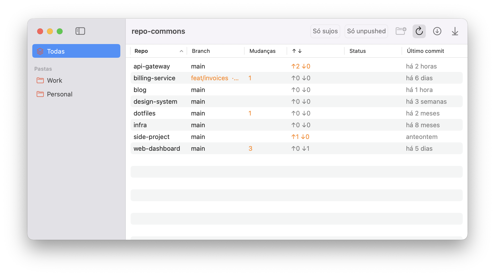

#  repo-commons
> Open source native macOS manager for many git repos: batch fetch/pull, uncommitted changes and unpushed commits at a glance.

If your projects live in a few folders like `~/Dev` and `~/Work`, repo-commons shows every repo in those folders in one window. For each repo you see the branch, uncommitted files, commits not yet pushed, and when the last commit happened. You can fetch or pull all of them at once. It is the "which of my 40 repos did I forget to push?" check, without opening 40 terminals.

It is a native SwiftUI app with no dependencies, built only with the Swift toolchain. It calls your own `git`, so your SSH keys, credential helpers and config work as they already do. Pull is always fast-forward only, so a batch pull never merges, rebases or leaves a repo in conflict. It is a clean-room project inspired by fleet-of-repos tools such as RepoFlock, written from scratch and licensed GPL-3.0.



## Installation

Requires macOS 14 or later and `git` at `/usr/bin/git`, which comes with the Xcode Command Line Tools (`xcode-select --install`). Xcode itself is not needed.

```sh
git clone https://github.com/romhenri/repo-commons.git
cd repo-commons
./bundle.sh
cp -R dist/RepoCommons.app /Applications/
```

`bundle.sh` builds a universal (Apple Silicon and Intel) app into `dist/RepoCommons.app` and a zipped copy in `dist/RepoCommons.zip`. The app is not notarized, so the first time, open it with right click > Open.

To update, quit the app and run the same `./bundle.sh` and copy again after a `git pull`.

## Usage example

The interface is in Brazilian Portuguese. Labels below are quoted as they appear in the app, with the English meaning in parentheses.

1. **Add folders.** Click the folder button in the toolbar ("Adicionar pasta") and pick one or more folders. Every git repo directly inside them (first level only) appears in the table. Folders are remembered between launches.
2. **Read the table.**

   | Column | Shows |
   |---|---|
   | Repo | Repo folder name |
   | Branch | Current branch. "· sem upstream" (no upstream) in orange when it was never pushed |
   | Mudanças (changes) | Number of uncommitted files: staged, modified and untracked, respecting `.gitignore`. Hover for the breakdown |
   | ↑ ↓ | Commits ahead of / behind the upstream. A "+N branch" badge means other local branches have unpushed commits too |
   | Status | Result of the last fetch or pull, or git's error message |
   | Último commit (last commit) | Relative date of the latest commit on the current branch |

   Click any column header to sort by it, and click again to reverse the order.
3. **Fetch or pull in batch.** The toolbar Fetch and Pull buttons act on the sidebar selection: "Todas" (all) or a single folder. Up to 4 repos run at a time. Pull is `git pull --ff-only`: a diverged branch fails with git's message and the repo is left untouched. Nothing is fetched or pulled automatically.
4. **Filter.** "Só sujos" (only dirty) shows repos with uncommitted changes. "Só unpushed" shows repos with commits to push or a branch without upstream.
5. **Work on a repo.** Double click opens it in Finder. Right click offers "Mostrar no Finder" (show in Finder), "Abrir no Terminal" (open in Terminal), "Abrir com Code" (VS Code), "Abrir com Zed" and "Copiar path" (copy path). Editors appear only when installed.
6. **Ignore a repo.** Right click > "Ignorar" (ignore) hides a repo and skips it in batch fetch/pull. Ignored repos are listed under "Ignorados" in the sidebar, where right click > "Deixar de ignorar" brings them back.

7. **Hand pending work to a coding agent.** Right click a folder in the sidebar > "Copiar relatório" (copy report) copies a Markdown list of that folder's repos with pending work (right click "Todas" for every folder), one absolute path per line with what is pending, ready to paste into a coding agent:

   ```
   Repos com mudanças pendentes em /Users/me/Work (3):

   - /Users/me/Work/api-gateway [main]: 2 commits não enviados
   - /Users/me/Work/billing-service [feat/invoices]: 1 arquivo não commitado, sem upstream
   - /Users/me/Work/web-dashboard [main]: 3 arquivos não commitados, 1 commit atrás do remoto
   ```

Status refreshes on launch, with the refresh button (⌘R), and after every fetch or pull.

## Development setup

The project is a Swift package. `RepoCommonsCore` holds the git logic and `RepoCommons` is the SwiftUI app.

```sh
swift run RepoCommons   # run the app in development
swift test              # integration tests
./bundle.sh             # build the .app and .zip into dist/
```

The tests are integration tests: each one creates real git repos and a bare remote in a temporary directory and runs the real `git`, covering status parsing, ahead/behind, branches without upstream, fetch, fast-forward pull and diverged pull. Contributor conventions (brand colour, UI language, git rules) are in [AGENTS.md](AGENTS.md).

## License

GPL-3.0. See [LICENSE](LICENSE).
